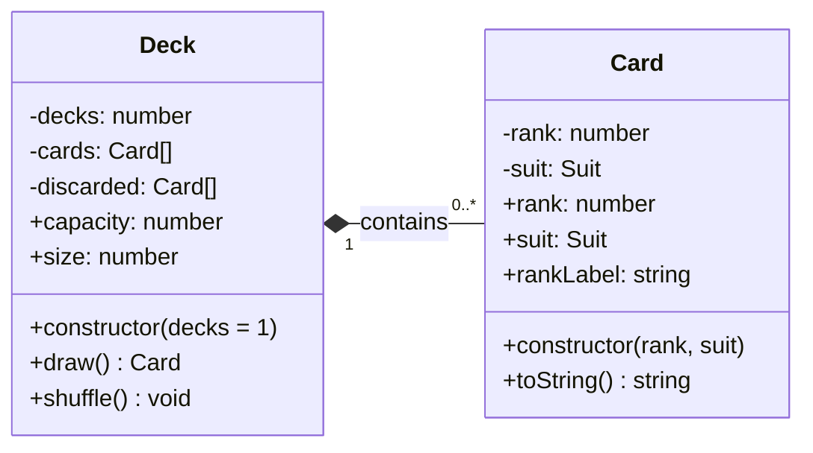

# Architecture

This document describes the main components of the Gracious Badger bot application and how they interact. Each section includes a short explanation and a diagram of the relevant design.

## Contents

- [Kevin - Slash Commands and Badger Den](#kevin--slash-commands-and-badger-den)
- [Harrison - Card and Deck](#harrison--card-and-deck)
- [Juan - Poker Game Logic](#juan--diagram-title)
- [Shiv - Database Diagram](#shiv--databasediagram)

---

## Interface Layer: Slash Commands and Badger Den

**Author:** Kevin

**Files:** `src/slashCommands.js`, `src/events/lobby.js`, `src/events/blackjackSlash.js`, `src/events/blackjack.js`

This layer is how users reach the bot. `src/slashCommands.js` registers two slash commands, `/badger-den` and `/blackjack`, with Discord for one server. `/badger-den` shows an embed that lists the available games. `/blackjack` starts the game by passing the interaction to the existing blackjack module, which was originally written for typed `!blackjack` messages.

### Figure 1: Control-Flow Graph of the Slash Command and Lobby Handlers


*Both listeners run on every interaction and exit early if the command isn't theirs. The blackjack listener adapts the slash command to the original prefix-based game.*

**Patterns**

- **Event-driven:** each handler is its own `interactionCreate` listener that returns early unless the command name matches.
- **Adapter:** the blackjack handler builds a `fakeMessage` with `author`, `content`, `channel`, and `reply`, so `blackjack.js` runs unchanged.

**How to add a new command**

1. Add a `SlashCommandBuilder` entry to the `commands` array in `src/slashCommands.js`.
2. Create an event file that returns early unless `commandName` matches.
3. Run `node src/slashCommands.js` (it replaces the server's registered commands, so keep every command in the array), then restart the bot.

**Known limitations**

- `original.execute()` returns once the game's message collector starts, so the adapter's `try/catch` only covers setup errors, not errors during later hit/stand turns.
- The Badger Den handler has no error handling.

---

## Harrison - Card and Deck
### Description

`Card` represents one playing card. Its private `rank` and `suit` fields are validated when the card is created; getters provide read-only access, and `toString()` produces a compact display label (such as `A♠`).

`Deck` creates 52 `Card` objects for each requested standard deck. It stores the available cards in a private array, supports in-place Fisher-Yates shuffling, and draws cards from the end of that array. The `capacity` getter reports the initial number of cards, while `size` reports how many remain. Drawing from an empty deck returns `undefined`.

### Class diagram



**Design notes:** `Deck` creates and manages its contained cards. `draw()` removes a card from the deck and returns it; the returned card can continue to exist independently. `Suit` is an exported constant object rather than a JavaScript class. `#discarded` is declared but not yet used.

---

## Juan - Poker Game Logic

### Description

There are five main phases to the upcoming poker game:
- Setup where players place initial bets and get their cards
- First betting round where players bet until everyone has folded or called
- Draw round where players change their cards
- Second betting round where players bet until everyone has folded or called
- Showdown where the winner is decided and awarded

Here is a link to the Miro board that clearly shows the steps - https://miro.com/app/board/uXjVEQs_BGQ=/?share_link_id=526915208911

### Diagram

```mermaid
flowchart TD
    %% Setup & Join
    P_Join[/Player tries to join/] --> HasCoins{Enough coins?}
    HasCoins -- No --> CantJoin[Unable to join]
    HasCoins -- Yes --> JoinGame[Join game]
    OpenGame[Open game] --> JoinGame
    JoinGame --> StartGame[Start game]
    StartGame --> AssignRoles[Designate Dealer & Big/Small Blind]
    AssignRoles --> PlaceBlinds[Big/Small Blind place bets]
    PlaceBlinds --> Shuffle[Build & shuffle deck]
    Shuffle --> DealCards[Deal 1 by 1 until everyone has 5 cards]

    %% Betting Round 1
    DealCards --> R1_Next[Next player]
    R1_Next --> R1_Act[/Player input action/]

    R1_Act -- Fold --> R1_Fold[Remove player from game]
    R1_Fold --> R1_CheckEnd{Has every player folded or called?}

    R1_Act -- Call --> R1_CallChips{Enough chips?}
    R1_CallChips -- Yes --> R1_CheckEnd
    R1_CallChips -- No --> R1_AllIn[Designate ALL IN & remove from betting]
    R1_AllIn --> R1_CheckEnd

    R1_Act -- Raise --> R1_Bet[/Player input bet/]
    R1_Bet --> R1_RaiseChips{Enough chips?}
    R1_RaiseChips -- No --> R1_Next
    R1_RaiseChips -- Yes --> R1_IncPot[Increase pot]
    R1_IncPot --> R1_CheckEnd

    R1_Act -- Check --> R1_PotInc{Has pot increased?}
    R1_PotInc -- Yes --> R1_Act
    R1_PotInc -- No --> R1_IsBB{Is player Big Blind?}
    R1_IsBB -- No --> R1_Next
    R1_IsBB -- Yes --> EndR1[End bet round 1]

    R1_CheckEnd -- No --> R1_Next
    R1_CheckEnd -- Yes --> EndR1

    %% Draw Phase
    EndR1 --> D_Next[Next player]
    D_Next --> D_Change{Change cards?}
    D_Change -- Yes --> D_Input[/Player input number of cards/]
    D_Input --> D_Deal[Discard and deal cards]
    D_Deal --> D_AllDone{Has every player changed or skipped?}
    D_Change -- No --> D_AllDone
    D_AllDone -- No --> D_Next
    D_AllDone -- Yes --> EndDraw[End draw phase]

    %% Betting Round 2
    EndDraw --> R2_Next[Next player]
    R2_Next --> R2_Act[/Player input action/]

    R2_Act -- Fold --> R2_Fold[Remove player from game]
    R2_Fold --> R2_CheckEnd{Has every player folded or called?}

    R2_Act -- Call --> R2_CallChips{Enough chips?}
    R2_CallChips -- Yes --> R2_CheckEnd
    R2_CallChips -- No --> R2_AllIn[Designate ALL IN & remove from betting]
    R2_AllIn --> R2_CheckEnd

    R2_Act -- Bet --> R2_BetPot{Has pot increased?}
    R2_BetPot -- Yes --> R2_Act
    R2_BetPot -- No --> R2_InputBet[/Player input bet/]

    R2_Act -- Raise --> R2_InputBet
    R2_InputBet --> R2_RaiseChips{Enough chips?}
    R2_RaiseChips -- No --> R2_Next
    R2_RaiseChips -- Yes --> R2_IncPot[Increase pot]
    R2_IncPot --> R2_CheckEnd

    R2_Act -- Check --> R2_CheckPot{Has pot increased?}
    R2_CheckPot -- Yes --> R2_Act
    R2_CheckPot -- No --> R2_CheckEnd

    R2_CheckEnd -- No --> R2_Next
    R2_CheckEnd -- Yes --> EndR2[End bet round 2]

    %% Showdown & Payout
    EndR2 --> Eval[Evaluate players hands: handRank]
    Eval --> BestHand[Determine player with highest rank hand]
    BestHand --> IsAllIn{Is winning player ALL IN?}
    IsAllIn -- No --> FullPot[Award full pot]
    IsAllIn -- Yes --> SidePot[Winner awarded from each player's bet up to their last bet]
```


---

## Shiv - Database Diagram

```text
1. What's in the database
dataBase.json
├── users: [                      one entry per person
│     {
│       user_id:      "1324..."   Discord ID
│       dailyCheckin: true/false  has this person checked in for the current day?
│       coins:        0           total earned
│     }
│   ]
├── last_online: <UTC time>       messages are scanned up to this point
└── last_reset:  <UTC time>       the last midnight that was processed
2. What changes the database

 TRIGGER                     FUNCTION              WHAT IT CHANGES
 ─────────────────────────   ───────────────────   ──────────────────────────
 User joins / !testwelcome → addUserToDataBase  →  adds user (false, 0 coins)

 Bot starts / midnight     → processCheckIns    →  dailyCheckin = true
                                                   adds unknown posters
                                                   last_online = end of scan

 A midnight has passed     → payAndReset        →  coins + 10 if flag is true
                                                   everyone's flag = false
                                                   last_reset = that midnight

 Very first start          → runDueResets       →  last_reset = now

 !checkusers               → loadDB             →  nothing (read only)
3. When the bot starts

                 npm start
                     │
                     ▼
        ┌──────────────────────────┐
        │ Is there a last_reset?   │── no ──► save last_reset = now ──┐
        └────────────┬─────────────┘                                  │
                     │ yes                                            │
                     ▼                                                │
        ┌──────────────────────────┐                                  │
   ┌───►│ Has the next midnight    │── no ────────────────────────────┤
   │    │ after last_reset passed? │                                  │
   │    └────────────┬─────────────┘                                  │
   │                 │ yes                                            │
   │                 ▼                                                │
   │          scan up to it,                                          │
   │          pay, and reset                                          │
   └─────────────────┘                                                │
                                                                      ▼
                              scan from last_online up to now (set flags)
                                                                      │
                                                                      ▼
                                              set a timer for next midnight
4. Every day at 12:00 AM

       timer fires
            │
            ▼
  1. SCAN   read messages from last_online up to midnight
            │
            ▼
  2. PAY    flag is true  ──► coins + 10
            │
            ▼
  3. RESET  everyone's flag = false
            │
            ▼
  4. SAVE   last_reset = this midnight
            │
            ▼
  5. REPEAT set a timer for the next midnight
5. Does a message count as a check-in?

   message in the window
            │
   Sent in CHANNEL_NAME? ── no ──► ignored
            │ yes
   Sent by a bot? ───────── yes ─► ignored
            │ no
   Sent during 11:59 PM? ── yes ─► ignored
            │ no
            ▼
   Author in database? ──── no ──► add them
            │ yes                     │
            ▼                         ▼
       dailyCheckin = true  ◄─────────┘
6. One user over two days

 Bot stays online the whole time

 TIME          EVENT                     dailyCheckin    coins
 ───────────   ───────────────────────   ────────────    ─────
 Mon 9:00 AM   posts in the channel      false *           0
 Tue 12:00 AM  scan                      true              0
 Tue 12:00 AM  pay and reset             false            10
 Tue           doesn't post              false            10
 Wed 12:00 AM  scan, pay, and reset      false            10   (no pay)
* The flag doesn't change when the person posts. It stays false until the next scan, so !checkusers can look behind during the day.

7. If the bot is offline

 Bot goes offline Mon 5 PM, restarts Wed 3 PM

 Mon ──────┬──────── Tue ───────────── Wed ──────┬─────►
       went offline                          restarted
           │                                     │
           ├─ Scan 1: up to Tue 12 AM ─ pay      │
           │                                     │
           ├─ Scan 2: up to Wed 12 AM ─ pay      │
           │                                     │
           └─ Scan 3: Wed 12 AM to 3 PM ─ flags only,
                                          paid tonight
Each missed day pays out separately, so nobody loses a day's coins, and no day gets paid twice.

Times are saved in UTC, but midnight and the 11:59 PM rule use the local time of the machine running the bot.
```
---
