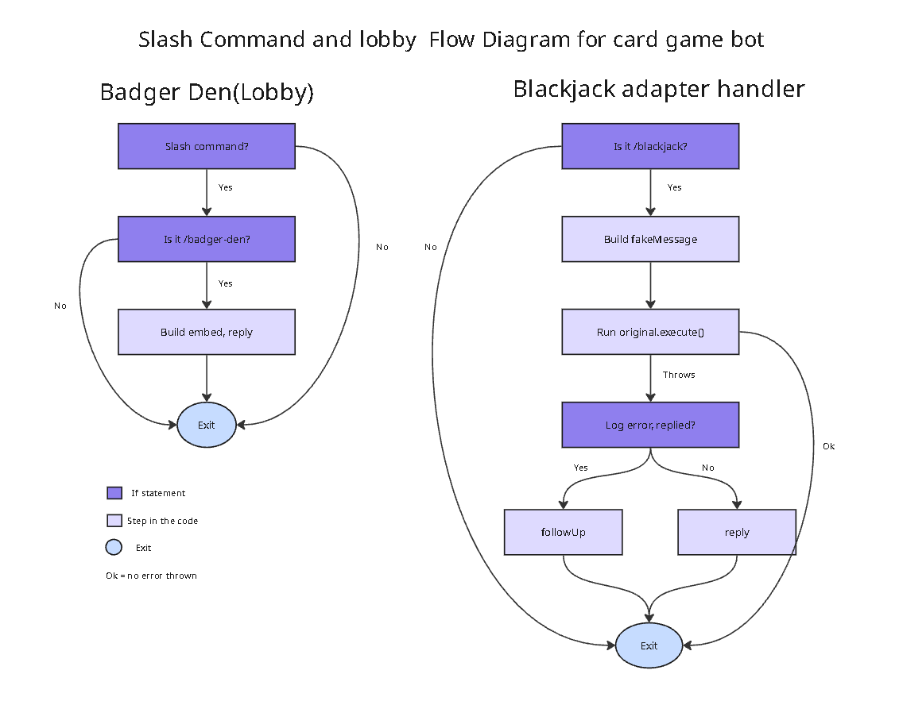
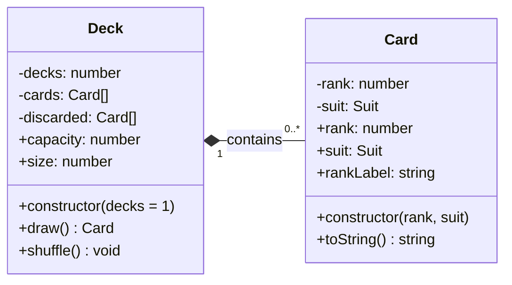

# Architecture

This document describes the main components of the Gracious Badger bot application and how they interact. Each section includes a short explanation and a diagram of the relevant design.

## Contents

- [Harrison - Card and Deck](#harrison--card-and-deck)
- [Juan - Diagram title](#juan--diagram-title)
- [Shiv - Diagram title](#shiv--diagram-title)
- [Kevin - Diagram title](#kevin--diagram-title)

---

========== Kevin - Slash commands and lobby (control-flow graph) ==========

## Interface Layer: Slash Commands and Badger Den

**Author:** Kevin

**Files:** `src/slashCommands.js`, `src/events/lobby.js`, `src/events/blackjackSlash.js`, `src/events/blackjack.js`

This layer is how users reach the bot. `src/slashCommands.js` registers two slash commands, `/badger-den` and `/blackjack`, with Discord for one server. `/badger-den` shows an embed that lists the available games. `/blackjack` starts the game by passing the interaction to the existing blackjack module, which was originally written for typed `!blackjack` messages.

### Figure 1: Control-Flow Graph of the Slash Command and Lobby Handlers

*Both listeners run on every interaction and exit early if the command isn't theirs. The blackjack listener adapts the slash command to the original prefix-based game.*

**Patterns**

- **Event-driven:** each handler is its own `interactionCreate` listener that returns early unless the command name matches.
- **Adapter:** the blackjack handler builds a `fakeMessage` with `author`, `content`, `channel`, and `reply`, so `blackjack.js` runs unchanged.

**How to add a new command**

1. Add a `SlashCommandBuilder` entry to the `commands` array in `src/slashCommands.js`.
2. Create an event file that returns early unless `commandName` matches.
3. Run `node src/slashCommands.js` (it replaces the server's registered commands, so keep every command in the array), then restart the bot.

**Known limitations**

- `original.execute()` returns once the game's message collector starts, so the adapter's `try/catch` only covers setup errors, not errors during later hit/stand turns.
- The Badger Den handler has no error handling.

---

## Harrison - Card and Deck
### Description

`Card` represents one playing card. Its private `rank` and `suit` fields are validated when the card is created; getters provide read-only access, and `toString()` produces a compact display label (such as `A♠`).

`Deck` creates 52 `Card` objects for each requested standard deck. It stores the available cards in a private array, supports in-place Fisher-Yates shuffling, and draws cards from the end of that array. The `capacity` getter reports the initial number of cards, while `size` reports how many remain. Drawing from an empty deck returns `undefined`.

### Class diagram

**Design notes:** `Deck` creates and manages its contained cards. `draw()` removes a card from the deck and returns it; the returned card can continue to exist independently. `Suit` is an exported constant object rather than a JavaScript class. `#discarded` is declared but not yet used.

---

## Juan - Diagram title

### Description

*Briefly describe the component(s)*

### Diagram

*Insert diagram here.*

---

## Shiv - Diagram title

### Description

*Briefly describe the component(s)*

### Diagram

*Insert diagram here.*

---
