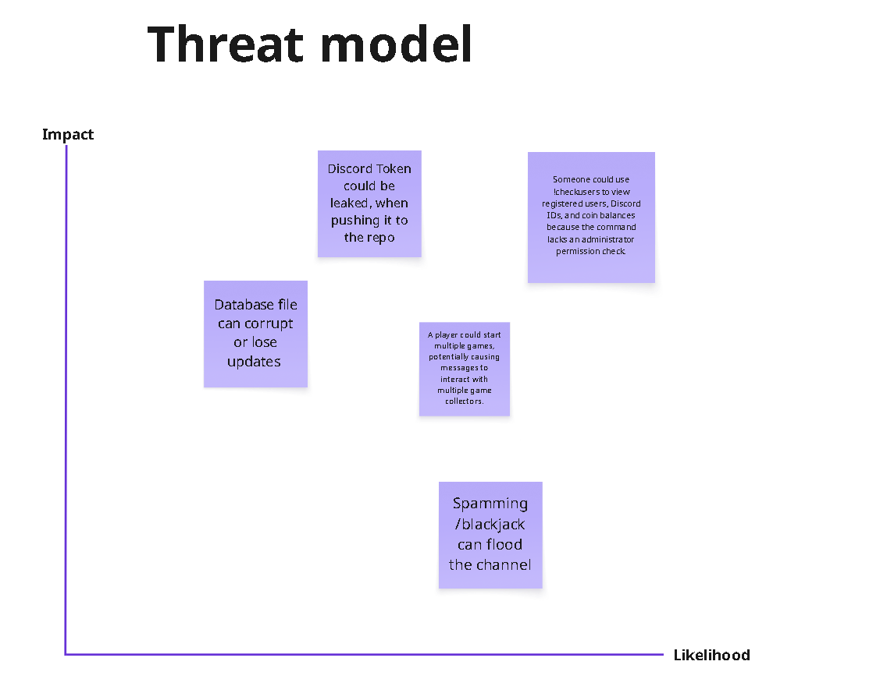

# Testing Report — Shiv

**Author:** Shiv (ShivanshBhatt2006)
**Date:** 2026-11-13
**Branch / commit:** `main` @ `5f1a6a5`
**Environment:** macOS, Node v24.16.0, npm 11.13.0 (clean `npm ci` install)

## Summary

| Check | Command | Result |
|---|---|---|
| Dependency audit (all) | `npm audit` | ❌ 24 vulnerabilities (1 critical, 15 high, 7 moderate, 1 low) |
| Dependency audit (production only) | `npm audit --omit=dev` | ❌ 7 vulnerabilities (1 critical, 3 high, 3 moderate) |
| Lint | `npx eslint .` | ❌ 12 errors, 0 warnings |
| Build | `npm run build` | ✅ Passes |
| Unit tests | `npm test` | ❌ No test files exist (`./tests/` folder is missing) |
| Outdated packages | `npm outdated` | ⚠️ 8 packages behind |

---

## 1. `npm audit`

### Production dependencies (these ship with the bot)

| Package | Severity | Comes from | Fix |
|---|---|---|---|
| `form-data` 4.0.0–4.0.5 | **Critical** | axios | `npm audit fix` |
| `axios` ≤0.33.0 | High | direct dependency (0.27.2) | Upgrade to `axios@1.x` (breaking) |
| `undici` ≤6.29.0 | High | discord.js | `npm audit fix` |
| `ws` 8.0.0–8.20.1 | High | discord.js | `npm audit fix` |
| `follow-redirects` ≤1.15.11 | Moderate | axios | `npm audit fix` |
| `file-type` 13.0.0–21.3.0 | Moderate | `@discordjs/rest` | `npm audit fix` |

**Note:** `axios` isn't imported anywhere in `src/`. We could just remove it (`npm uninstall axios`), which also removes the axios-related `form-data` and `follow-redirects` issues, with no code changes.

### Dev-only dependencies (used for building and testing; not shipped)

| Package | Severity | Comes from | Fix |
|---|---|---|---|
| `brace-expansion`, `braces`, `picomatch` | High | nodemon / mocha / eslint | `npm audit fix` |
| `minimatch` | High | eslint 10, mocha, nodemon | `npm audit fix --force` would downgrade eslint to 9 (not recommended); wait for an eslint patch |
| `js-yaml`, `nanoid`, `serialize-javascript`, `diff` | High / Low | mocha 10.0.0 | `npm audit fix` (updates mocha within v10) |
| `get-func-name` | High | chai 4.3.6 | `npm audit fix` |
| `semver` | High | nodemon 2.x | Upgrade to `nodemon@3` (breaking) |
| `esbuild` ≤0.24.2 | Moderate | direct (0.15.9) | Upgrade to `esbuild@0.28` (breaking); only affects the esbuild dev server, which we don't use |

**Recommendation:** first run `npm audit fix`. It needs no breaking changes and fixes most of the list. Then remove `axios` and upgrade `nodemon` to v3.

---

## 2. ESLint (`npx eslint .`)

Config: `eslint.config.mjs` (`js/recommended`, Node globals). **12 errors:**

| File | Line | Rule | Issue |
|---|---|---|---|
| [src/events/blackjack.js](src/events/blackjack.js#L137) | 137 | `no-useless-assignment` | `resultText` initial value never used |
| [src/events/blackjack.js](src/events/blackjack.js#L138) | 138 | `no-useless-assignment` | `color` initial value never used |
| [src/events/blackjack.js](src/events/blackjack.js#L178) | 178 | `no-useless-assignment` | `res` initial value never used |
| [src/events/blackjack.js](src/events/blackjack.js#L216) | 216 | `no-useless-assignment` | `summary` initial value never used |
| [src/events/blackjack.js](src/events/blackjack.js#L217) | 217 | `no-useless-assignment` | `finalColor` initial value never used |
| [src/events/blackjack.js](src/events/blackjack.js#L243) | 243 | `no-useless-assignment` | `label` initial value never used |
| [src/events/guildMemberAdd.js](src/events/guildMemberAdd.js#L4) | 4 | `no-unused-vars` | `MEME_URL` is never used |
| [src/events/guildMemberAdd.js](src/events/guildMemberAdd.js#L22) | 22 | `no-unused-vars` | `getWelcomeMessage` is never used |
| [src/events/guildMemberAdd.js](src/events/guildMemberAdd.js#L45) | 45 | `no-useless-escape` | Unnecessary `\'` |
| [src/events/guildMemberAdd.js](src/events/guildMemberAdd.js#L46) | 46 | `no-useless-escape` | Unnecessary `\'` |
| [src/games/cards/Deck.js](src/games/cards/Deck.js#L6) | 6 | `no-unused-private-class-members` | `#discarded` is never used |
| [src/games/poker/handRank.js](src/games/poker/handRank.js#L5) | 5 | `no-unused-vars` | `Tier` is never used |

All 12 are code-quality issues (dead code or unneeded initial values), not runtime bugs. The `blackjack.js` ones can be fixed by declaring the variables without an initial value (`let resultText;`). Note that `getWelcomeMessage` being unused may mean the welcome message feature isn't wired up yet.

---

## 3. Build (`npm run build`)

✅ esbuild compiled all 19 files in `src/` into `build/` with no errors.

⚠️ `src/commands/poker.js` and `src/games/poker/poker.js` compile to **0 bytes**. They contain only comments or placeholders, so poker isn't implemented yet.

---

## 4. Unit tests (`npm test`)

❌ `Error: No test files found: "./tests/*.spec.js"`

The `test` script expects `./tests/*.spec.js`, but the repo has no `tests/` folder. Mocha and Chai are installed and ready. Good first candidates for tests, since they are pure logic with no Discord dependency:

- `src/games/cards/Deck.js` / `Card.js`: deck has 52 unique cards, shuffling, drawing
- `src/games/poker/handRank.js`: hand ranking (pair, flush, straight, …)
- Blackjack `calculateScore` (aces counted as 1 or 11, bust over 21)
- `src/helpers/manDataBase.js` / `dailyReset.js` / `checkIns.js`: database read/write and reset logic

---

## 5. Outdated packages (`npm outdated`)

| Package | Current | Wanted (in range) | Latest |
|---|---|---|---|
| axios | 0.27.2 | 0.27.2 | 1.21.1 |
| chai | 4.3.6 | 4.5.0 | 6.3.0 |
| discord.js | 14.5.0 | 14.28.1 | 14.28.1 |
| dotenv | 16.0.2 | 16.6.1 | 18.0.10 |
| esbuild | 0.15.9 | 0.15.18 | 0.28.2 |
| esbuild-runner | 2.2.1 | 2.2.2 | 2.2.2 |
| mocha | 10.0.0 | 10.8.2 | 12.0.3 |
| nodemon | 2.0.20 | 2.0.22 | 3.1.14 |

`discord.js` is 23 minor versions behind. Upgrading within v14 should be safe and picks up the `undici` and `ws` security fixes.

---

## Action items for the group

1. Run `npm audit fix` (no breaking changes) and commit the updated `package-lock.json`.
2. Remove the unused `axios` dependency.
3. Fix the 12 ESLint errors listed above.
4. Create `tests/` and add `*.spec.js` tests, starting with Deck, hand ranking, and blackjack scoring.
5. Upgrade `nodemon` to v3 and `discord.js` to the latest 14.x.
6. Consider adding `"lint": "eslint ."` to the `package.json` scripts and running it in CI (`.github/`).

# Harrison Butler - Code Smell Report: Discord Bot (poker\_logic branch)

Nov 13, 2026

## Summary

On the poker\_logic branch (commit 137f335), cyclomatic complexity is low overall but concentrated in two files. Across 134 functions (about 1,390 lines in src/), the total is 391, the mean is 2.9 and the median is 1. Eight functions score above 10.

blackjack.js (82 points) and the new poker.js (112 points) hold half the total, but they differ in kind. blackjack.js is one 266-line function. poker.js is split into 13 small functions whose scores come from flat input checks, such as validate (14) and normalize (15). Both smells below are in blackjack.js.

Measured with ESLint's complexity rule, which adds 1 for each if, loop, case, catch, ?: and each &&, || or ??. The lint run found no undefined names, and blackjack.js caused 5 of the 6 size-limit warnings.

## Smell 1: God function in blackjack.js

execute in blackjack.js is a 266-line function that owns the whole game: dealing, the natural-21 check, the embed UI, input handling and the payout. Inside it are two closures that score highest in the codebase.

| Function | Complexity | Lines | Statements |
| --- | --- | --- | --- |
| resolveGame | 21 | 106 | 62 |
| collect handler | 16 | 74 | 50 |
| execute (own body) | 8 | 266 | — |

ESLint's limits are 60 lines and 25 statements per function. The closures share four mutable variables (hands, currentHandIdx, hasSplit, canSplit), so no piece can be tested or reused on its own.

Most of the complexity is duplication, not blackjack's rules. resolveGame writes the win/lose/push ladder twice: once for a single hand and once for split hands. The collect handler repeats the "advance to the next hand, then resolve or redraw" block three times.

## Smell 2: Two card systems

The repo has two unrelated card models. games/cards defines Card and Deck classes, which the finished poker game in poker.js draws from, while blackjack.js builds its own deck from plain objects.

|  | games/cards (poker) | blackjack.js |
| --- | --- | --- |
| Card | Card class: numeric rank 2–14, Suit objects | { suit: '♠', value: 'K' } |
| Deck | Deck class: shuffle, draw(n), multi-deck and custom decks | createDeck() returns an array of 52 |
| Shuffle | Fisher–Yates in Deck.shuffle | Fisher–Yates again in createDeck |
| Rank value | Number, ace = 14 | String, parsed on every score in calculateScore |

Any fix to shuffling, card display or parsing has to be made twice, and the copies will drift apart. Blackjack also re-parses strings (J/Q/K lookups, parseInt) on every score, where a numeric rank would do.

## Recommendation

1. Move blackjack onto games/cards: draw Card objects from a Deck and add a blackjack value helper (ace = 1 or 11, faces = 10). This deletes createDeck and the duplicate shuffle.
2. Pull the game out of the Discord handler into a BlackjackGame class in games/blackjack, mirroring PokerGame. Game state lives in the object, and execute only renders embeds and routes input.
3. Treat a normal game as a split with one hand. One settle loop then replaces both result ladders, and one advanceHand() replaces the three copies.

Estimated result: resolveGame drops from 21 to about 8 and the collect handler from 16 to about 6. The game logic also becomes unit-testable without Discord.

# Testing Report — Kevin
Threat model- Kevin 
This is a model to show potenial threats that could happen with the graph below show how likey and the impact it has.

| Threat | Proposed solution |
|---|---|
| Discord token leakage | Use environment variables and exclude `.env` from Git |
| Database corruption | Implement atomic writes and serialized updates |
| Blackjack spam | Add command cooldowns |
| Unauthorized user information | Add administrator permission checks |
| Multiple Blackjack games | Prevent multiple active sessions per player |

Technical Debt and Code Smells — Kevin
1. Overview
I reviewed the Gracious Badger poker bot source code to identify the top three I think are the technical debt and code smells that could affect its reliability, security, and maintainability.
2. Identified Issues
Issue 1: Database Reliability

File: src/helpers/manDataBase.js

The bot writes user information directly to a JSON file. If multiple updates happen close together, they could overwrite each other. Write errors are also caught without being passed back to the calling functions.

Suggested improvement: Implement safer database writes and better error handling.
Issue 2: Unused Code

Files: src/events/guildMemberAdd.js, src/games/cards/Deck.js

Some unused variables and functions were identified, including MEME_URL, getWelcomeMessage(), and #discarded.

Suggested improvement: Remove unnecessary code or finish the functionality if it is still needed.

Issue 3: Command Permissions

File: src/events/messageCreate.js

The !checkusers command displays user IDs and coin balances without checking administrator permissions.

Suggested improvement: Restrict the command to authorized administrators.
 3. Summary

| Issue | Improvement |
|---|---|
| Database reliability | Safer database writes and error handling |
| Unused code | Remove unnecessary code |
| Command permissions | Add administrator checks |
4. Conclusion

The analysis I made identified problems involving database reliability, unused code, error handling, and command permissions. Fixing these issues would make the Gracious Bagers poker bot to be more secure, reliable, and easier to maintain.
5. Time/Reflection
I spent about 2hour and 30mins think of possable threats to are poker bot and then spent another 2-3 hour reviewing the soure code and creating a report for technical debt and code smells. During this process, I identified potential security risks, database reliability issues, unused code, and missing command permissions. This helped me better understand the weaknesses in the Gracious Badger poker bot and identify improvements that could make it more secure, reliable, and easier to maintain.

Total time spent: 4-5 hours.

# Testing Report — Juan

## Unit Tests

### Time required
* This took a couple hours.
* Involved creating a file named `*.spec.js` (`blackjack.spec.js`) in a new `tests` folder in order to run unit tests using Mocha with the `npm test` command.
* The test file includes unit tests for the following functions (using `expect` from Chai):
  * `calculateScore()`
  * `canSplitPair()`
  * `determineOutcome()`
* From writing the unit tests, I found that it would be useful to write additional tests for each method in `blackjack.js`.
* I also thought it would be useful to write unit tests for the calls to games from slash commands since they are at the intersection of mine and Kevin's work and we have had what we believed to be compatibility issues with the slash commands and games in the past.

### Screenshot

### User story
* https://github.com/CSS360-2026-Au-D/memebot_discord_a26-group4/issues/45

---

## Continuous Integration

### Time required
* This took about an hour.
* I was able to use my work from the previous task by including `npm test` in the script for CI.
* This involved creating a script to create a VM that tests the build and functions specifically when there are pull requests and merges.
* After creating the script and looking at Shiv's test report, I thought that it would be useful to add ESLint to the script.

### Screenshot

### User story
* https://github.com/CSS360-2026-Au-D/memebot_discord_a26-group4/issues/44

